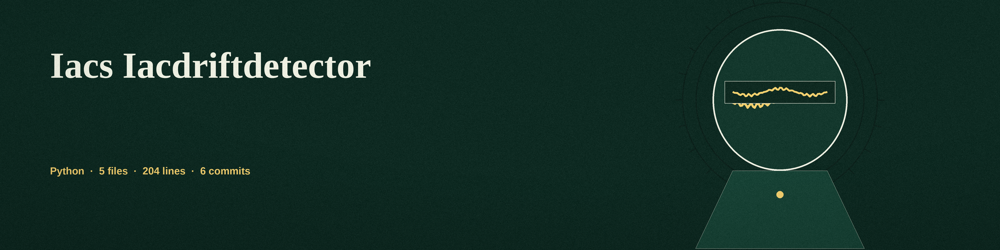

# iacs-IaCDriftDetector
A command-line tool that compares an IaC configuration file with a deployed state file at JSONPath expressions and logs drift with both values shown. The exit code is 1 when any check reports drift and 0 when every compared value matches, so a script can gate on the result. A path present on one side only counts as drift. A check whose expression matches nothing on either side is an error at exit 1, not a clean pass, and comparison errors exit 1 as well instead of folding into a no drift result. With no -j expression, three default checks run (S3 bucket ACL, security group ingress CIDR blocks, database storage encryption); their expressions carry a wildcard label segment, so labelled resources such as resource.aws_s3_bucket.example.acl are matched, with the unlabelled shape as a fallback. Dependencies: `jsonpath_ng` and `PyYAML`, listed in requirements.txt. Input files are YAML or JSON.

## Install
`git clone https://github.com/ShadowStrikeHQ/iacs-iacdriftdetector`

## Usage
`python3 main.py -i iac.yaml -d deployed.yaml`
`python3 main.py -i iac.yaml -d deployed.yaml -j '$.resource.aws_s3_bucket.*.acl' -desc "S3 Bucket ACL"`

## Parameters
- `-h`: Show help message and exit
- `-i`: Path to the IaC configuration file (YAML or JSON)
- `-d`: Path to the file containing the deployed infrastructure state (YAML or JSON)
- `-j`: JSONPath expression to compare. If not provided, the default security checks run.
- `-desc`: Description of the comparison (required with -j)

## License
Copyright (c) ShadowStrikeHQ
